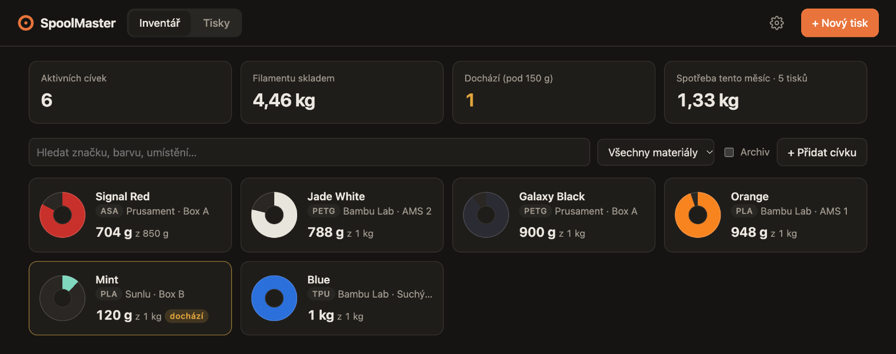

<h1 align="center">🧵 SpoolMaster</h1>

  <b>Vždycky víš, kolik filamentu ti zbývá.</b> 
  Domácí evidence cívek pro 3D tisk: inventář, spotřeba podle tisků a (brzy) archiv 3MF projektů.

  

---

## Proč

Než pustíš osmihodinový tisk, chceš vědět, jestli na cívce zbývá 300 gramů, nebo jen 80.
Odhad podle oka nefunguje, převažovat každou cívku před tiskem nikoho nebaví a tabulky se
po třetím tisku přestanou vyplňovat.

SpoolMaster to řeší jednoduše. Každou cívku zapíšeš jednou, pak ke každému tisku zadáš gramy
ze sliceru a zůstatek se odečte sám. Kdykoli vidíš, co máš skladem, co dochází a kolik
filamentu tento měsíc prošlo tiskárnou.

## Co umí

- 🎨 **Inventář cívek**: značka, materiál, barva, umístění, cena. Kruh u každé cívky ukazuje,
  kolik filamentu zbývá.
- ➖ **Odečet podle tisků**: zadáš gramy ze sliceru a odečtou se z cívky. Vícebarevný tisk z AMS
  bere z více cívek najednou.
- ⚖️ **Převážení**: položíš cívku na váhu, odečte se hmotnost prázdné cívky a zůstatek se opraví.
  Rozdíl se zapíše do historie.
- ↩️ **Nic se neztratí**: zůstatek se pokaždé dopočítá z historie, takže smazání nebo úprava
  tisku gramy na cívku vrátí.
- 📋 **Fronta tisků**: tisk naplánuješ dopředu a filament se jen zarezervuje. Po dotisku klepneš
  **Hotovo**, nebo **Selhalo** a zadáš, kolik procent se vytisklo. Gramy se přepočítají samy.
- 🗂️ **Projekty**: tisky seskupíš do projektu a vidíš jeho celkovou gramáž a cenu, včetně toho,
  kolik stály nepovedené pokusy.
- 💰 **Cena tisku**: filament podle ceny cívky a elektřina podle času tisku. Počítá se v dolarech
  (cívku jde zadat i v eurech nebo korunách) a vedle je přepočet na koruny podle denního kurzu ČNB.
  Když cena chybí, aplikace napíše „cena neznámá“, nikdy si nevymyslí nulu.
- ⚠️ **Upozornění, že dochází**: cívky pod nastavenou hranicí jsou vidět na první pohled.
- 📊 **Přehled**: kolik máš skladem, kolik dochází a kolik se spotřebovalo tento měsíc.
- 💾 **Záloha jedním klikem**: export celé databáze ke stažení.
- 📱 **Funguje na mobilu**: zápis přímo u tiskárny.

## Kam to směřuje

| Fáze | Obsah | Stav |
| --- | --- | --- |
| 1 | Docker image pro NAS, migrace databáze, nastavení | ✅ hotovo |
| 2 | Projekty, fronta naplánovaných tisků, cena tisku (filament + elektřina) | ✅ hotovo |
| 3 | Import 3MF z Bambu Studia: gramáž po filamentech, náhled, „vytisknout znovu“ | 🔜 další |
| 4 | Ikona na plochu mobilu (PWA) a doladění mobilu | ⏳ plán |

Cílový postup: po slicování nahraješ 3MF na počítači a tisk se sám zařadí do fronty se správnou
gramáží i časem. Po dotisku na mobilu klepneš **Hotovo** nebo **Selhalo**.

## Pro koho

Pro jednoho tiskaře a jeho dílnu. Aplikace běží doma (typicky v Dockeru na NASu), nemá
přihlašování a data nikam neodesílá. Vznikla pro Bambu Lab X1C s AMS, ale ruční evidence
funguje s jakoukoli tiskárnou.

## Pod kapotou

Node.js + Express a SQLite přímo v Node (`node:sqlite`). Frontend je čisté HTML, CSS a JavaScript
bez build kroku. Celá aplikace je pár souborů a jeden Docker image pro amd64 i arm64.

## Spuštění

Lokální vývoj a nasazení na NAS jsou popsané v **[docs/SETUP.md](docs/SETUP.md)**.
